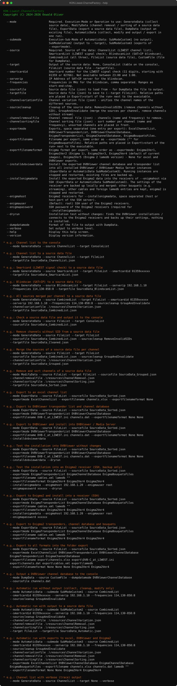

# KON.Liwest.ChannelFactory
Fetching, parsing and creating LIWEST DVB-C channel data for various backends (Excel, DVBViewer, Enigma2)

## Usage



<details>
<summary>Help as text</summary>

```text
KON.Liwest.ChannelFactory
Copyright (C) 2024-2026 Oswald Oliver

  --mode                    Required. Execution-Mode or Operation to use: GenerateData (collect
                            source data), ModifyData (channel removal / sorting of a source data
                            file), ExportData (export a source data file), DumpData (output an
                            existing file), AutomaticData (collect, modify and output / export in
                            one run).
  --submode                 Execution-Sub-Mode of AutomaticData: SubModeCustom1 (no output),
                            SubModeCustom2 (output to --target), SubModeCustom3 (exports of
                            --exportmode).
  --source                  Required. Source of the data: ChannelList (LIWEST channel list),
                            SmartcardList (LIWEST signal check), BlindscanList (SAT>IP blindscan),
                            CombinedList (all three), FileList (source data file), CustomFile (file
                            for DumpData).
  --target                  Output of the source data: None, ConsoleList (table on the console),
                            FileList (source data file --targetfile).
  --smartcardid             Smartcard number for the LIWEST signal check (11 digits, starting with
                            01359 or 02766). Not available between 23:00 and 1:00.
  --serverip                IP Address of SAT>IP server for the blindscan.
  --frequencies             Frequencies in MHz for the blindscan, comma separated. Ranges as
                            start-end:step.
  --sourcefile              Source data file (json) to load from - for DumpData the file to output.
  --targetfile              Source data file (json) to save to (--target FileList).
  --channelvariationfile    Channel variation file (json) - unifies the channel names of the
                            different sources.
  --sourcecleanup           Cleanup of the source data: RemoveInvalidSIDs (remove channels without
                            SID), GroupAndInvalidate (merge the sources per channel, remove channels
                            without stream).
  --channelremovalfile      Channel removal file (json) - channels (name and frequency) to remove.
  --channelsortingfile      Channel sorting file (json) - sort number per channel (name and
                            frequency), unsorted channels are placed in front.
  --exportmode              Exports, space separated (one entry per export): ExcelChannelList,
                            DVBViewerTransponderList, DVBViewerChannelDatabase,
                            EnigmaTransponderList, EnigmaChannelDatabase, EnigmaBouquetsFiles.
  --exportfilename          Filename per export, same order as --exportmode ("" for
                            EnigmaBouquetsFiles - written to the current directory).
  --exportfilenameformat    Enigma format per export, same order as --exportmode: Enigma1Ver1,
                            Enigma1Ver2 (Enigma 1), Enigma2Ver3, Enigma2Ver4 (default of current
                            images), Enigma2Ver5 (Enigma 2 lamedb version) - None for excel and
                            DVBViewer exports.
  --installdvbviewerdata    Install the exported DVBViewer channel database and transponder list
                            into all installed DVBViewer / DVBViewer Media Server instances
                            (ExportData or AutomaticData SubModeCustom3). Running instances are
                            stopped and restarted, existing files are backed up.
  --dumpdatamode            Format of the file to output with DumpData.
  --verbose                 Set output to verbose level.
  --help                    Display this help screen.
  --version                 Display version information.

* e.g.: Channel list to the console
    --mode GenerateData --source ChannelList --target ConsoleList

* e.g.: Channel list to a source data file
    --mode GenerateData --source ChannelList --target FileList
    --targetfile SourceData_ChannelList.json

* e.g.: Smartcard (LIWEST signal check) to a source data file
    --mode GenerateData --source SmartcardList --target FileList --smartcardid 01359xxxxxx
    --targetfile SourceData_SmartcardList.json

* e.g.: Blindscan (SAT>IP) to a source data file
    --mode GenerateData --source BlindscanList --target FileList --serverip 192.168.1.10
    --frequencies 114,130-858:8 --targetfile SourceData_BlindscanList.json

* e.g.: All sources merged per channel to a source data file
    --mode GenerateData --source CombinedList --target FileList --smartcardid 01359xxxxxx
    --serverip 192.168.1.10 --frequencies 114,130-858:8 --sourcecleanup GroupAndInvalidate
    --channelvariationfile .\resources\ChannelVariation.json
    --targetfile SourceData_CombinedList.json

* e.g.: Check a source data file and output it to the console
    --mode GenerateData --source FileList --target ConsoleList
    --sourcefile SourceData_CombinedList.json

* e.g.: Remove channels without SID from a source data file
    --mode GenerateData --source FileList --target FileList
    --sourcefile SourceData_CombinedList.json --sourcecleanup RemoveInvalidSIDs
    --targetfile SourceData_Cleaned.json

* e.g.: Merge the sources of a source data file per channel
    --mode GenerateData --source FileList --target FileList
    --sourcefile SourceData_CombinedList.json --sourcecleanup GroupAndInvalidate
    --channelvariationfile .\resources\ChannelVariation.json
    --targetfile SourceData_Grouped.json

* e.g.: Remove and sort channels of a source data file
    --mode ModifyData --source FileList --target FileList --sourcefile SourceData_Grouped.json
    --channelremovalfile .\resources\ChannelRemoval.json
    --channelsortingfile .\resources\ChannelSorting.json
    --targetfile SourceData_Sorted.json

* e.g.: Export to an excel channel list
    --mode ExportData --source FileList --sourcefile SourceData_Sorted.json
    --exportmode ExcelChannelList --exportfilename channels.xlsx --exportfilenameformat None

* e.g.: Export to DVBViewer transponder list and channel database
    --mode ExportData --source FileList --sourcefile SourceData_Sorted.json
    --exportmode DVBViewerTransponderList DVBViewerChannelDatabase
    --exportfilename DVB-C_at_LIWEST.ini channels.dat --exportfilenameformat None None

* e.g.: Export to DVBViewer and install into DVBViewer / Media Server
    --mode ExportData --source FileList --sourcefile SourceData_Sorted.json
    --exportmode DVBViewerTransponderList DVBViewerChannelDatabase
    --exportfilename DVB-C_at_LIWEST.ini channels.dat --exportfilenameformat None None
    --installdvbviewerdata

* e.g.: Export to Enigma2 transponders, channel database and bouquets
    --mode ExportData --source FileList --sourcefile SourceData_Sorted.json
    --exportmode EnigmaTransponderList EnigmaChannelDatabase EnigmaBouquetsFiles
    --exportfilename cables.xml lamedb ""
    --exportfilenameformat Enigma2Ver4 Enigma2Ver4 Enigma2Ver4

* e.g.: Export to all formats into the folder export
    --mode ExportData --source FileList --sourcefile SourceData_Sorted.json
    --exportmode ExcelChannelList DVBViewerTransponderList DVBViewerChannelDatabase
    EnigmaTransponderList EnigmaChannelDatabase
    --exportfilename export\channels.xlsx export\DVB-C_at_LIWEST.ini
    export\channels.dat export\cables.xml export\lamedb
    --exportfilenameformat None None None Enigma2Ver4 Enigma2Ver4

* e.g.: Output a DVBViewer channel database to the console
    --mode DumpData --source CustomFile --dumpdatamode DVBViewerChannelDatabase
    --sourcefile channels.dat

* e.g.: Automatic run without output (collect, cleanup, modify only)
    --mode AutomaticData --submode SubModeCustom1 --source CombinedList
    --smartcardid 01359xxxxxx --serverip 192.168.1.10 --frequencies 114,130-858:8
    --sourcecleanup GroupAndInvalidate

* e.g.: Automatic run with output to a source data file
    --mode AutomaticData --submode SubModeCustom2 --source CombinedList
    --smartcardid 01359xxxxxx --serverip 192.168.1.10 --frequencies 114,130-858:8
    --sourcecleanup GroupAndInvalidate
    --channelvariationfile .\resources\ChannelVariation.json
    --channelremovalfile .\resources\ChannelRemoval.json
    --channelsortingfile .\resources\ChannelSorting.json
    --target FileList --targetfile SourceData_Automatic.json

* e.g.: Automatic run with exports to excel, DVBViewer and Enigma2
    --mode AutomaticData --submode SubModeCustom3 --source CombinedList
    --smartcardid 01359xxxxxx --serverip 192.168.1.10 --frequencies 114,130-858:8
    --sourcecleanup GroupAndInvalidate
    --channelvariationfile .\resources\ChannelVariation.json
    --channelremovalfile .\resources\ChannelRemoval.json
    --channelsortingfile .\resources\ChannelSorting.json
    --exportmode ExcelChannelList DVBViewerChannelDatabase EnigmaChannelDatabase
    EnigmaBouquetsFiles --exportfilename channels.xlsx channels.dat lamedb ""
    --exportfilenameformat None None Enigma2Ver4 Enigma2Ver4

* e.g.: Channel list with verbose (trace) output
    --mode GenerateData --source ChannelList --target None --verbose
```

</details>

## Modes

| Mode | Description |
|---|---|
| `GenerateData` | Collects source data from the LIWEST channel list, the smartcard check, a blindscan (SAT>IP) or a source data file, optionally cleans it up and writes it to the console or a source data file |
| `ModifyData` | Loads a source data file, removes channels (`--channelremovalfile`) and sorts them (`--channelsortingfile`) |
| `ExportData` | Loads a source data file and exports it - several exports per run, `--exportmode`, `--exportfilename` and `--exportfilenameformat` are given as lists of the same length |
| `DumpData` | Prints the content of an existing file (e.g. DVBViewer channel database) |
| `AutomaticData` | Runs channel list, smartcard and blindscan, cleanup, removal and sorting in one go - `SubModeCustom2` writes the target, `SubModeCustom3` runs the exports |

## Sources and data

* Channel list: LIWEST channel list (tv and radio csv)
* Smartcard: LIWEST signal check api - not available between 23:00 and 1:00 (maintenance window of the api)
* Blindscan: SAT>IP server via [KON.OctoScan.NET](https://github.com/h0ly0ne/KON.OctoScan.NET)
* Source data file: json array of channels with the property names of the source data (`ChannelName`, `ChannelFrequency`, `SID`, ...), not listed properties stay empty
* Frequencies are always stored in kHz - input values like `578`, `578000` or `578.00 MHz` are normalized
* `Sources` lists the sources of a channel (`ChannelList`, `SmartcardList`, `BlindscanList`) - after `--sourcecleanup GroupAndInvalidate` all merged sources
* `Package`: with `--sourcecleanup GroupAndInvalidate` the package of the smartcard wins, the channel list is only used if the smartcard delivers none
* `Package`: html of the smartcard api is converted to text - line breaks (`<br />`) become ` / `, other tags are removed, entities decoded

## Encryption

The blindscan delivers:

* `Encrypted` - decision of KON.OctoScan.NET: the measured scrambling bits win, without measurement the PMT CA_descriptor / SDT free_CA_mode is used
* `CASystemIDs` - CA_system_IDs of the PMT CA_descriptors (hex, comma separated)

Exports:

* DVBViewer: encrypted flag of the channel from `Encrypted`
* Enigma (lamedb): encrypted services get one `C:xxxx` entry per CA_system_ID, `C:0000` if no CA_system_ID is known - unencrypted services get none

Channels without `Encrypted` (e.g. no blindscan data or older source data files) are exported as not encrypted - regenerate older source data files with a current blindscan.
Channel list, smartcard and blindscan data of one channel are only combined with `--sourcecleanup GroupAndInvalidate`.

## Dolby

The blindscan delivers the codec per audio pid (`APIDSCODEC`: MPEG, AAC, AC3, EAC3, AC4, DTS, TRUEHD, UNKNOWN).
`Dolby` is true if at least one audio pid is AC3, EAC3 or AC4 - with `--sourcecleanup GroupAndInvalidate` the measured value wins over the channel list.
The DVBViewer export sets the audio format from the codec as well (stream type only if no codec is known).

## Codec

`Codec` contains the video codec (`MPEG2`, `H264`, `HEVC`, `VVC`, `AVS`, ...), for services without video the codec of the first audio pid (`MPEG`, `AAC`, `AC3`, ...).
The blindscan derives it from the video stream type (`VPIDST`) resp. the audio codecs (`APIDSCODEC`) - with `--sourcecleanup GroupAndInvalidate` this value wins over the smartcard.
Spellings of the smartcard are unified (`MPEG4` -> `H264`).

## Language

`Language` is always stored as 3 letter ISO 639-2/T code (e.g. `DE`, `ger` -> `deu`), several languages comma separated.
The blindscan sets it to the language of the first audio pid with a real language (placeholders like `und`, `mis` or `qaa` are skipped) - with `--sourcecleanup GroupAndInvalidate` this value wins over the channel list / smartcard.
Channels without any language get `und` (undetermined).

## Resource files

| File | Option | Content |
|---|---|---|
| `resources/ChannelVariation.json` | `--channelvariationfile` | Primary channel name and its variations (different spellings of the sources) |
| `resources/ChannelRemoval.json` | `--channelremovalfile` | Channels (name and frequency) to remove |
| `resources/ChannelSorting.json` | `--channelsortingfile` | Sort number per channel (name and frequency) - channels without sort number are placed in front |

Channel names are matched case-insensitive.

## Output files

All output files are resolved relative to the current working directory, absolute paths are kept and missing directories are created.
Enigma bouquet files (`--exportmode EnigmaBouquetsFiles`) are written into the current working directory.

## DVBViewer installation

`--installdvbviewerdata` (with `ExportData` or `AutomaticData` / `SubModeCustom3` and a DVBViewer export) installs the DVBViewer files exported in this run into all installed DVBViewer / DVBViewer Media Server instances:

* Installations are found by their uninstall entries (DVBViewer Pro, DVBViewer Media Server, DVBViewer Recording Service, DVBViewer GE)
* The data directory is defined by `usermode.ini` of the program directory: `UserMode` 0 = program directory, 1 = application data of the user, 2 = common application data (`C:\ProgramData`), each with `Root` (e.g. `CMUV\DVBViewer`)
* `channels.dat` is copied to the data directory, the transponder list to `<data directory>\Transponders`
* Existing files are backed up as `<file>.<yyyyMMdd-HHmmss>.bak`
* Running programs of the instance are closed (terminated if they do not close within 30 seconds) and restarted, running services (Media Server) are stopped and restarted
* Only files written successfully in this run are installed

## Enigma formats

`--exportfilenameformat` uses the names and versions of the EnigmaSettings library:

| Value | Format |
|---|---|
| `Enigma1Ver1` | Enigma 1, version 1 |
| `Enigma1Ver2` | Enigma 1, version 2 |
| `Enigma2Ver3` | Enigma 2, lamedb version 3 |
| `Enigma2Ver4` | Enigma 2, lamedb version 4 (default of current images) |
| `Enigma2Ver5` | Enigma 2, lamedb version 4 + lamedb5 |

## Exit codes

| Code | Meaning |
|---|---|
| `0` | Success (also for `--help` / `--version`) |
| `1` | Invalid or missing arguments |
| `2` | Operation failed - at least one error has been reported |
| `3` | Prerequisites not met (firewall rules could not be created - run as administrator on a Windows client) |

## Requirements

* Windows client, run as administrator (firewall rules are created like in KON.OctoScan.NET)
* .NET 10
